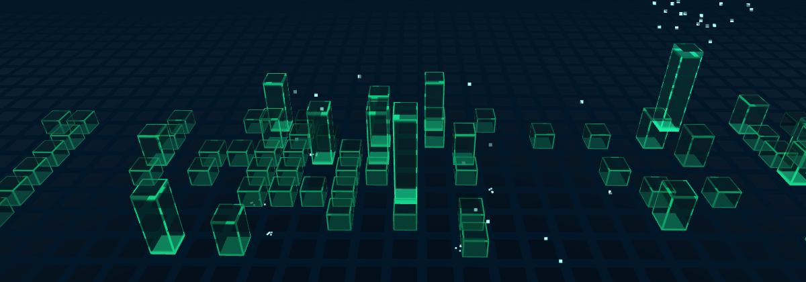

import Feature from "@/components/guide/Feature.astro";
import Features from "@/components/guide/Features.astro";
import LiveDemo from "@/components/guide/LiveDemo.astro";
import NextStep from "@/components/guide/NextStep.astro";
import NextSteps from "@/components/guide/NextSteps.astro";

`@abhiramkrishna/contribution-skyline` draws a year of GitHub contributions as glowing bars. They rise week by week, each bar twinkles on its own 13–21 second cycle, and the busiest days flash and burst into pixels that fall and shatter on the floor. It's the About section of [abhiramkrishna.com](https://www.abhiramkrishna.com).

## See it live

It runs live below. The playground has every control, with code for JavaScript, Vue, React and Web Components that updates as you change them.

<LiveDemo slug="contribution-skyline" />

<Features>
  <Feature title="Standalone">
    A self-contained scene in any container. The camera fits the whole year to its size.
  </Feature>
  <Feature title="On the spacetime grid">
    A layer whose bars stand on the animated tiles and light up the days beneath them.
  </Feature>
  <Feature title="2D calendar">
    Plain HTML with no three.js, for phones and server-rendered pages.
  </Feature>
  <Feature title="No token needed">
    Public contributions come from the same page github.com shows. A token only matters for private ones, and never reaches the browser.
  </Feature>
</Features>

| On the spacetime grid | Rising (`progress: 0.45`) |
|---|---|
|  |  |

<NextSteps>
  <NextStep title="Getting started" description="Get your data and show the skyline." href="/contribution-skyline/getting-started/" />
  <NextStep title="Getting the data" description="Build time, serverless or server, and private contributions." href="/contribution-skyline/data/" />
</NextSteps>
