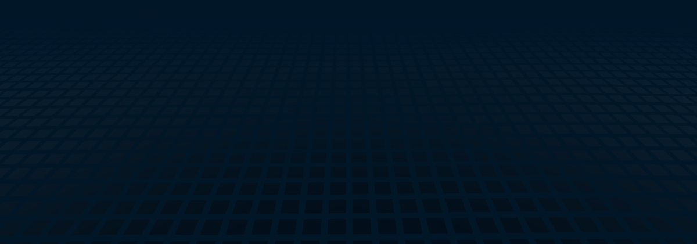
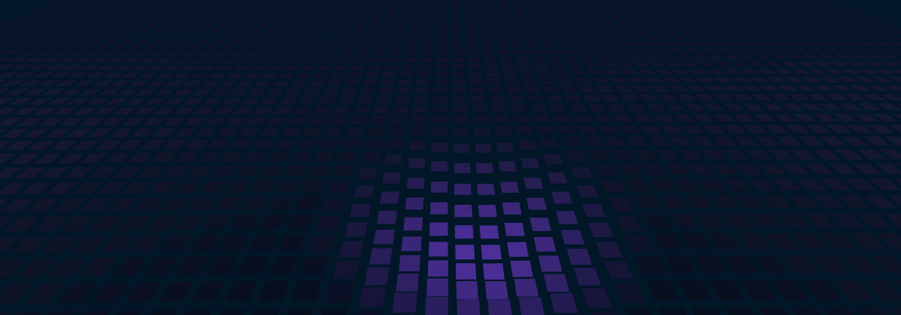

import Feature from "@/components/guide/Feature.astro";
import Features from "@/components/guide/Features.astro";
import LiveDemo from "@/components/guide/LiveDemo.astro";
import NextStep from "@/components/guide/NextStep.astro";
import NextSteps from "@/components/guide/NextSteps.astro";

`@abhiramkrishna/spacetime-grid` is the animated background from [abhiramkrishna.com](https://www.abhiramkrishna.com). It's a field of tiles: idle waves roll across it, the tiles under your cursor sink into a gravity well, and a click sends an energy ring across the surface.

## See it live

It runs live below. The playground has every control, with code for JavaScript, Vue, React and Web Components that updates as you change them.

<LiveDemo slug="spacetime-grid" />

<Features>
  <Feature title="Cursor gravity well">
    Tiles sink and light up under the mouse, then ease back when it moves on.
  </Feature>
  <Feature title="Click ripples">
    Each click or tap sends a ring outward. You can also start one from code with `grid.ripple()`.
  </Feature>
  <Feature title="Plugins">
    Camera moves driven by scroll, wells that follow elements, and data overlays such as the contribution skyline.
  </Feature>
  <Feature title="Built to stay out of the way">
    About 0.3 ms of CPU per frame, paused when off-screen or in a hidden tab, and a still frame for reduced motion.
  </Feature>
</Features>

| Idle waves | Click ripple | Custom theme |
|---|---|---|
|  |  |  |

It's written in plain TypeScript on three.js, with thin wrappers for Vue, React and Web Components.

<NextSteps>
  <NextStep title="Getting started" description="Install it and put a grid behind your page." href="/spacetime-grid/getting-started/" />
  <NextStep title="Options" description="All 28 options, with defaults and ranges." href="/spacetime-grid/options/" />
</NextSteps>
