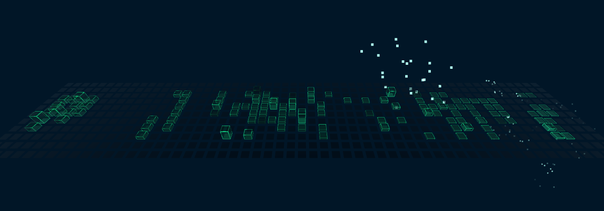
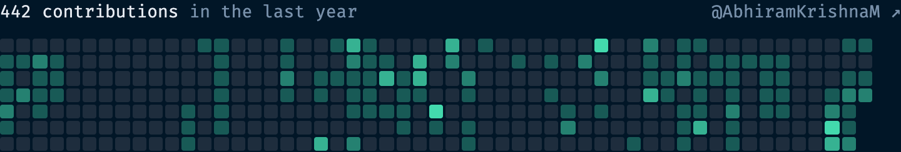

# @abhiramkrishna/contribution-skyline

A year of GitHub contributions drawn as glowing 3D bars. They rise week by week, each one twinkles on its own cycle, and the busiest days flash and burst into pixels that fall and shatter on the floor. It's the About section of [abhiramkrishna.com](https://www.abhiramkrishna.com), packaged so you can use it three ways:

- **Standalone:** its own small scene in any container.
- **As a layer** on [`@abhiramkrishna/spacetime-grid`](../spacetime-grid), with bars standing on the animated tiles.
- **As a flat 2D calendar:** plain HTML with no three.js, for phones or server-rendered pages.

| Standalone | On the spacetime grid |
|---|---|
|  |  |
| **Rising (`progress: 0.45`)** | **2D calendar** |
|  |  |

Getting the data needs **no GitHub token**: public contributions come from the same page github.com shows. A token is only needed for private contributions, and the package only ever uses it on a server or at build time, never in the browser.

## Install

```sh
npm install @abhiramkrishna/contribution-skyline three
```

`three` is a peer dependency (≥ 0.160). `@abhiramkrishna/spacetime-grid` installs with it. Vue (≥ 3.3) and React (≥ 18) are optional peers, needed only for their wrappers.

| Import | Contains | three.js? |
|---|---|---|
| `@abhiramkrishna/contribution-skyline` | `ContributionSkyline` (standalone), `contributionSkyline()` (layer), schema | yes |
| `…/calendar` | The 2D calendar | no |
| `…/fetch` | `fetchContributions`, `createContributionsHandler` (server only) | no |
| `…/vue`, `…/react`, `…/element` | Wrappers | only for the 3D components |

## The data

Every component takes the same JSON:

```ts
interface ContributionData {
  user: string;
  total: number;
  fetchedAt: string | null;
  days: { date: string; level: 0 | 1 | 2 | 3 | 4; count: number }[];
}
```

`days` runs oldest to newest, starting on a Sunday. That's 53 weeks × 7 days for a full year. There are three ways to get it.

### 1. At build time (simplest)

```sh
npx contribution-skyline-fetch your-username --out src/data/contributions.json
```

Run it before your build, for example as a `prebuild` script, and import the JSON. If GitHub can't be reached, it keeps the previous file, so a failed fetch never breaks a deploy.

### 2. From a serverless function

```ts
import { createContributionsHandler } from "@abhiramkrishna/contribution-skyline/fetch";

export const GET = createContributionsHandler({ cacheSeconds: 3600 });
```

It's a standard `Request → Response` handler, so it works on Vercel, Netlify, Cloudflare Workers and Next.js route handlers.
- **Responses:** it reads `?user=` and returns the JSON with CDN cache headers. A bad username gets 400, an unknown user 404, and a GitHub failure 502.
- **One user only:** pass `{ user: "you" }` to serve a single account.

### 3. Anywhere on a server

```ts
import { fetchContributions } from "@abhiramkrishna/contribution-skyline/fetch";

const data = await fetchContributions("your-username");
```

GitHub's contributions page has no CORS headers, so these helpers can't run in the browser. Call them on a server, in a function or at build time, and pass the JSON to the components.

### Private contributions

Without a token you get what anyone sees on your GitHub profile. With a token, the helpers use GitHub's GraphQL API instead:

```ts
await fetchContributions("your-username", { token: process.env.GITHUB_TOKEN });
createContributionsHandler({ user: "your-username", token: process.env.GITHUB_TOKEN });
```

For the CLI, set the token in the `CONTRIBUTIONS_TOKEN` environment variable.

GitHub decides what each route returns:

- **Profile setting, no token:** with **Include private contributions on my profile** turned on in your GitHub settings, private work appears as anonymous counts on your public calendar, which the token-free fetch reads.
- **Token from your own account:** the GraphQL API returns the calendar as GitHub shows it to that account.

What's included depends on GitHub's rules for your account, so compare the result with your profile once.

**Keep the token on the server.** `fetchContributions` throws an error if it's given a token in a browser.

## Standalone

```ts
import { ContributionSkyline } from "@abhiramkrishna/contribution-skyline";
import data from "./data/contributions.json";

const skyline = new ContributionSkyline(document.getElementById("skyline")!, data, {
  progress: 1,
  theme: { hover: "#5ee6ff", fog: "#011627" },
});
```

- **Sizing:** give the container a size. The scene is a tile floor sized to the data, and the camera refits whenever the container resizes, so the whole year always shows.
- **Interaction:** the floor still has the cursor gravity well and click ripples, because it's a spacetime grid with its waves turned off.
- **Shape:** a year is about 7:1, so the scene suits wide containers. On phones, the 2D calendar reads better.

```ts
skyline.setProgress(0.5);
skyline.setOptions({ barScale: 1.4, floor: false });
skyline.setTheme({ hover: "#c58cff" });
skyline.setData(newData);
skyline.destroy();
```

`skyline.grid` (the `SpacetimeGrid`) and `skyline.layer` give full access. To change the floor's grid options, such as `cellSize`, pass `{ grid: { … } }` to the constructor.

## As a layer on the spacetime grid

```ts
import { SpacetimeGrid } from "@abhiramkrishna/spacetime-grid";
import { contributionSkyline } from "@abhiramkrishna/contribution-skyline";

const grid = new SpacetimeGrid(document.getElementById("background")!);
const skyline = contributionSkyline(data, {
  progress: () => aboutSectionProgress(),
});
grid.use(skyline);
```

- **Floor:** the bars stand on the grid's tiles and ride its waves, wells and ripples. Active days also light up the tiles beneath them through `grid.glow`.
- **Colour:** the bars take the grid's highlight colour unless you set `color`.

**Placement.** By default the block is centred on the grid. There are two other options:

- `origin: { col, row }`: the exact first tile; the year's oldest day goes at the back-left.
- `anchor: { ndc: [x, y], pose }`: centre the block where a screen point (−1…1) meets the grid, as seen from a camera pose. Use this when the camera flies around and the block should sit in view at one particular pose. The portfolio uses `{ ndc: [0, -0.45], pose: aboutPose }`.

**Driving `progress` from scroll.** Pass a function. It's read every frame, so the bars follow the scroll position both ways.

## 2D calendar

```ts
import { renderContributionCalendar, contributionCalendarHTML } from "@abhiramkrishna/contribution-skyline/calendar";

const calendar = renderContributionCalendar(document.getElementById("calendar")!, data);
calendar.update(newData);

const html = contributionCalendarHTML(data, { caption: true, link: true, locale: "en-US" });
```

`contributionCalendarHTML` returns a string, so the calendar can be rendered on the server with no JavaScript in the browser.
- **Accessibility:** the grid has `role="img"` and an `aria-label` ("442 GitHub contributions in the last year"), and each day has a hover title.
- **Narrow screens:** the grid scrolls sideways inside itself.

Theme it with CSS variables on the container or any parent:

| Variable | Default | |
|---|---|---|
| `--cs-accent` | `#43d9ad` | Base colour; levels 1–4 use it at 35 / 55 / 80 / 100 % |
| `--cs-level-1` … `--cs-level-4` | from `--cs-accent` | Override one level |
| `--cs-empty` | `#1e2d3d` | Days with no contributions |
| `--cs-cell-size`, `--cs-gap`, `--cs-radius` | `0.6rem`, `2px`, `2px` | Cell shape (`--cs-radius: 50%` for dots) |
| `--cs-text`, `--cs-strong`, `--cs-link` | `#7890aa`, `#e5e9f0`, inherit | Caption colours |

## Options

**Bars**

| Option | Default | Description |
|---|---|---|
| `progress` | `1` (0–1) | How far the bars have risen (0 = flat, 1 = full). Pass a function in code to drive it from scroll. |
| `barScale` | `1` (0–3) | Multiplier for bar heights. |
| `barOpacity` | `0.85` (0–1) | Opacity of the bars. |
| `stagger` | `0.55` (0–2) | How much later each week rises than the one before (0 = all at once). |
| `glowStrength` | `1` (0–2) | How strongly active days light up the grid tiles underneath. |

**Colours**

| Option | Default | Description |
|---|---|---|
| `color` | `""` | Bar and particle colour. Leave empty to follow the grid's highlight colour. |

**Twinkle**

| Option | Default | Description |
|---|---|---|
| `twinkle` | `true` | Each bar dims briefly on its own 13–21 s cycle. |
| `twinkleDepth` | `0.8` (0–1) | How far a bar dims during a twinkle. |

**Bursts**

| Option | Default | Description |
|---|---|---|
| `bursts` | `true` | The busiest days flash and burst into falling pixels. |
| `burstLevel` | `4` (1–4) | Minimum contribution level (1–4) that bursts. |
| `burstMinInterval` | `3.5` (0.5–30) | Shortest gap between bursts from one bar, in seconds. |
| `burstMaxInterval` | `8` (0.5–30) | Longest gap between bursts from one bar, in seconds. |
| `sparkSize` | `5` (1–12) | Size of the rising sparks, in CSS pixels. |
| `shardSize` | `2.6` (0.5–8) | Size of the shards that scatter on landing, in CSS pixels. |

**Motion**

| Option | Default | Description |
|---|---|---|
| `reducedMotionProgress` | `1` (0–1) | Progress shown when motion is reduced, instead of the animated value. |
| `reducedMotion` ¹ | `"auto"` (`auto` / `always` / `never`) | auto follows prefers-reduced-motion; always renders a still frame; never always animates. |

**Scene**

| Option | Default | Description |
|---|---|---|
| `floor` ¹ | `true` | Show the tile floor under the bars. |
| `cameraElevation` ¹ | `0.5` (0.1–1.4) | How steeply the camera looks down, in radians. |

¹ Standalone only. The layer follows the grid's own motion setting.

`CONTRIBUTION_SKYLINE_SCHEMA` exports this table as data, with the same shape as the grid's schema plus a `standaloneOnly` flag. `DEFAULT_SKYLINE_SETTINGS` and `DEFAULT_STANDALONE_SETTINGS` hold the defaults. All options are live: change them with `setOptions` on the skyline or the layer.

### Reduced motion

With `prefers-reduced-motion: reduce`, the scene renders one still frame, with no twinkle, bursts or cursor effects. The bars show at `reducedMotionProgress` (default `1`, fully risen) instead of the animated `progress`. That's because a scroll-driven value can't animate in a still frame, so a reduced-motion visitor would otherwise never see the bars rise. The 2D calendar never animates.

## Wrappers

### Vue

```vue
<script setup lang="ts">
import { ContributionSkyline, ContributionCalendar } from "@abhiramkrishna/contribution-skyline/vue";
import data from "./data/contributions.json";
</script>

<template>
  <div class="skyline"><ContributionSkyline :data="data" :bar-scale="1.2" color="#5ee6ff" /></div>
  <ContributionCalendar :data="data" :link="false" />
</template>
```

### React

```tsx
import { ContributionSkyline, ContributionCalendar } from "@abhiramkrishna/contribution-skyline/react";
import data from "./data/contributions.json";

export function Contributions() {
  return (
    <>
      <div className="skyline"><ContributionSkyline data={data} barScale={1.2} color="#5ee6ff" /></div>
      <ContributionCalendar data={data} caption={false} />
    </>
  );
}
```

**Both wrappers:**
- **Props:** every option is a prop, plus `data`, `progress` (a number or function), `theme` and `grid`.
- **Updates:** changed props update in place, and new `data` keeps the same scene. Changing `grid` rebuilds it.
- **Instance:** you get the `ContributionSkyline` instance through a template ref (`skyline`) or a React `ref`, and from `ready` / `onReady`.
- **Bundle size:** the calendar component renders from the HTML string, so it works with server rendering and never loads three.js.

For layer mode, there's no separate component: pass the layer into the grid wrapper's `plugins` prop.

```tsx
const plugins = useMemo(() => [contributionSkyline(data, { progress: () => scroll })], [data]);
<SpacetimeGrid plugins={plugins} />
```

### Web Components

```ts
import { defineContributionSkylineElement, defineContributionCalendarElement } from "@abhiramkrishna/contribution-skyline/element";

defineContributionSkylineElement();
defineContributionCalendarElement();
```

```html
<contribution-skyline src="/api/contributions?user=you" bar-scale="1.2" theme-hover="#5ee6ff" style="height: 320px"></contribution-skyline>
<contribution-calendar src="/data/contributions.json" link="false"></contribution-calendar>
```

- **Data:** `src` fetches the JSON, from a static file or the handler above. You can also set the `data` property.
- **Options:** kebab-case attributes, such as `bar-scale` and `reduced-motion-progress`. Theme colours are `theme-base`, `theme-hover`, `theme-fog` and `theme-fresnel`. The `progress` and `grid` properties take a function or an object.
- **Events:** `load`, `error` and `ready`.

## License

MIT © Abhiram Krishna M
