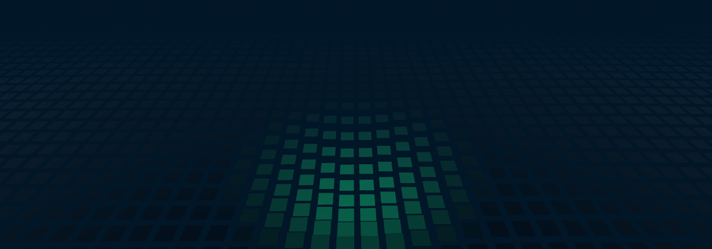
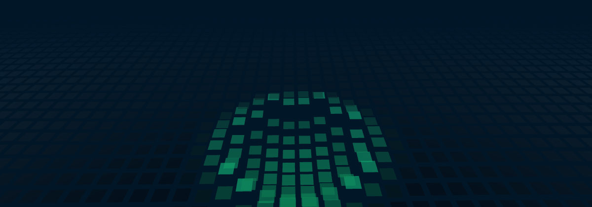

# @abhiramkrishna/spacetime-grid

An animated three.js grid of tiles: idle waves roll across it, tiles sink into a gravity well under the cursor, and clicks send energy rings across the surface. It's the background of [abhiramkrishna.com](https://www.abhiramkrishna.com), packaged as a framework-agnostic component with Vue, React and Web Component wrappers.

| Idle waves | Cursor gravity well |
|---|---|
|  |  |
| **Click ripple** | **Custom theme** |
|  |  |

- One instanced mesh: 3,840 tiles by default, about 0.3 ms of CPU per frame in a 4×-CPU-throttled Chromium test.
- Pauses when the canvas is off-screen or the tab is hidden.
- Respects `prefers-reduced-motion` with a still frame.
- Plugins for scroll-driven camera moves, wells that follow elements, and data overlays.
- 28 options, all described by an exported schema you can build a settings UI from.

## Install

```sh
npm install @abhiramkrishna/spacetime-grid three
```

`three` is a peer dependency (≥ 0.160), so the grid uses your app's copy. Vue (≥ 3.3) and React (≥ 18) are optional peers, needed only for their wrappers.

## Quick start

```ts
import { SpacetimeGrid } from "@abhiramkrishna/spacetime-grid";

const grid = new SpacetimeGrid(document.getElementById("background")!);
```

Pass any element. The grid adds a canvas that fills it and follows its size, so give the element a size:

```css
#background {
  position: fixed;
  inset: 0;
  z-index: -1;
}
```

You can also pass a `<canvas>` you already have. The grid listens for the mouse and clicks on `window`, so it keeps working behind your page content. Positions are mapped onto the canvas, and anything outside it is ignored.

Call `grid.destroy()` when you're done. It stops the loop, removes the listeners and frees the GPU resources.

## Options

```ts
const grid = new SpacetimeGrid(el, {
  cols: 80,
  waveAmplitude: 0.12,
  wellRadius: 3,
  theme: { base: "#123a55", hover: "#5ee6ff", fog: "#04223a", fresnel: "#d8f4ff" },
});

grid.setOptions({ rippleSpeed: 3.5, theme: { hover: "#ff9e7a" } });
```

Options marked **live** can be changed at any time with `setOptions`. The others (`cols`, `rows`, `cellSize`, `fill`) set the size of the tile mesh, so to change them, create a new grid. The wrappers below do that for you.

**Theme.** `theme.fog` should match the page background, so tiles fade into it.

**Grid**

| Option | Default | Live | Description |
|---|---|---|---|
| `cols` | `64` (8–160) | no | Number of tile columns. |
| `rows` | `60` (8–160) | no | Number of tile rows. |
| `cellSize` | `0.34` (0.1–1) | no | Distance between tile centres, in world units. |
| `fill` | `0.72` (0.1–1) | no | How much of each cell a tile covers (1 = no gap). |
| `tileOpacity` | `0.55` (0–1) | yes | Opacity of every tile. |

**Waves**

| Option | Default | Live | Description |
|---|---|---|---|
| `waveAmplitude` | `0.09` (0–0.4) | yes | Height of the idle waves. |
| `waveSpeed` | `1` (0–4) | yes | Speed multiplier for the idle waves. |
| `sway` | `0.03` (0–0.2) | yes | How far the whole grid rocks from side to side, in radians. |

**Gravity well**

| Option | Default | Live | Description |
|---|---|---|---|
| `cursorWell` | `true` | yes | Sink the tiles under the mouse cursor. |
| `wellRadius` | `2.2` (0.2–6) | yes | Radius of the cursor well, in world units. |
| `wellDepth` | `0.55` (0–2) | yes | How deep the cursor well sinks the tiles. |
| `wellEase` | `0.1` (0.01–1) | yes | How quickly tiles follow the well each frame (1 = instantly). |

**Ripples**

| Option | Default | Live | Description |
|---|---|---|---|
| `ripples` | `true` | yes | Send an energy ring across the grid on click or tap. |
| `rippleSpeed` | `2.4` (0.2–8) | yes | How fast a ripple ring spreads, in world units per second. |
| `rippleWidth` | `0.55` (0.05–2) | yes | Thickness of the ripple ring. |
| `rippleHeight` | `0.55` (0–2) | yes | How high the ripple ring lifts the tiles. |
| `rippleLifetime` | `2.4` (0.2–8) | yes | Seconds before a ripple fades out. |

**Colours**

| Option | Default | Live | Description |
|---|---|---|---|
| `theme.base` | `"#0c1f33"` | yes | Resting tile colour. |
| `theme.hover` | `"#43d9ad"` | yes | Colour of tiles in a well, ripple or data glow. |
| `theme.fog` | `"#011627"` | yes | Fog colour; match it to the page background. |
| `theme.fresnel` | `"#bfe9ff"` | yes | Fresnel rim colour on tiles seen at a grazing angle. |

**Fog**

| Option | Default | Live | Description |
|---|---|---|---|
| `fogNear` | `5` (0–30) | yes | Distance where the fog begins. |
| `fogFar` | `12` (1–60) | yes | Distance where tiles fully fade into the fog. |

**Camera**

| Option | Default | Live | Description |
|---|---|---|---|
| `fov` | `50` (20–100) | yes | Vertical field of view, in degrees. |
| `cameraEase` | `0.06` (0.01–1) | yes | How quickly the camera moves toward its target each frame. |

**Rendering**

| Option | Default | Live | Description |
|---|---|---|---|
| `maxPixelRatio` | `2` (0.5–3) | yes | Upper limit on the device pixel ratio; lower is faster. |
| `compactBreakpoint` | `1024` (0–2000) | yes | Below this canvas width (px) the grid drops lower and shrinks, for phones. |
| `reducedMotion` | `"auto"` (`auto` / `always` / `never`) | yes | auto follows prefers-reduced-motion; always renders a still frame; never always animates. |

`SPACETIME_GRID_SCHEMA` exports the table above as data, one entry per option: `key`, `label`, `group`, `type`, `default`, `min`/`max`/`step` or `choices`, `description` and `live`. `DEFAULT_SETTINGS` and `DEFAULT_THEME` hold the defaults.

### Reduced motion

By default (`reducedMotion: "auto"`), visitors with `prefers-reduced-motion: reduce` get a single still frame. It's redrawn on resize, theme changes and plugin changes, but it never animates, and the cursor and clicks do nothing. If the visitor changes the setting while the page is open, the grid switches over. Use `"always"` to force the still frame, or `"never"` to always animate.

## Wrappers

Every option is a prop. Each wrapper also takes `theme` and `plugins`, and gives you the `SpacetimeGrid` instance. Live props update the grid in place. Changing `cols`, `rows`, `cellSize` or `fill` rebuilds it.

### Vue

```vue
<script setup lang="ts">
import { SpacetimeGrid } from "@abhiramkrishna/spacetime-grid/vue";
import type { SpacetimeGrid as Grid } from "@abhiramkrishna/spacetime-grid";

function onReady(grid: Grid) {
  grid.ripple(innerWidth / 2, innerHeight / 2);
}
</script>

<template>
  <div class="background">
    <SpacetimeGrid :wave-amplitude="0.12" :theme="{ hover: '#5ee6ff' }" @ready="onReady" />
  </div>
</template>
```

A template ref on the component exposes `grid`.

### React

```tsx
import { useRef } from "react";
import { SpacetimeGrid } from "@abhiramkrishna/spacetime-grid/react";
import type { SpacetimeGrid as Grid } from "@abhiramkrishna/spacetime-grid";

export function Background() {
  const grid = useRef<Grid>(null);
  return (
    <div className="background">
      <SpacetimeGrid ref={grid} waveAmplitude={0.12} theme={{ hover: "#5ee6ff" }} />
    </div>
  );
}
```

It also accepts `className`, `style` and `onReady`. Keep the `plugins` array stable (for example with `useMemo`), because a new array re-adds the plugins.

### Web Component

```ts
import { defineSpacetimeGridElement } from "@abhiramkrishna/spacetime-grid/element";

defineSpacetimeGridElement();
```

```html
<spacetime-grid wave-amplitude="0.12" theme-hover="#5ee6ff" style="position: fixed; inset: 0"></spacetime-grid>
```

- **Registration:** nothing is registered until you call `defineSpacetimeGridElement(tagName?)`, so importing the module has no side effects and is safe during server rendering.
- **Attributes:** options are kebab-case attributes (`wave-amplitude`, `cursor-well="false"`). Theme colours are `theme-base`, `theme-hover`, `theme-fog` and `theme-fresnel`.
- **Properties:** `el.options = { … }` sets options from JavaScript, and `el.use(plugin)` adds a plugin.
- **Instance:** `el.grid` is the instance, and a `ready` event fires each time one is created.

## Plugins

Plugins hook into each frame. Two come with the package.

### `scrollCamera`: fly between camera poses as the page scrolls

```ts
import { SpacetimeGrid, scrollCamera } from "@abhiramkrishna/spacetime-grid";

const poses = {
  hero: { position: [0, 1.3, 6], lookAt: [0, -1, -3] },
  about: { position: [1.7, 1.15, 5], lookAt: [1.4, -1, -3] },
} as const;

grid.use(scrollCamera({
  poses,
  initial: "hero",
  segments: () => [{ from: "hero", to: "about", start: 0, end: window.innerHeight }],
}));
```

- `segments` is called every frame, so it can read fresh section offsets.
- Between `start` and `end` (scroll pixels), the camera eases from one pose to the next, and the grid smooths the move by `cameraEase`.
- To drive it from something other than `window.scrollY`, pass `scroll: () => number`.
- With reduced motion, the camera stays on `initial`.

### `elementWell`: a gravity well that follows an element

```ts
import { elementWell } from "@abhiramkrishna/spacetime-grid";

grid.use(elementWell(() => document.querySelector(".dialog"), {
  radius: 4.2,
  depth: 1.15,
  strength: () => dialogProgress,
}));
```

The well sits under the element's centre. `strength` scales its depth; at `0` or below, the well is off.

### Impulses

For a one-off ripple at a screen point, such as an object landing on the grid, call:

```ts
grid.ripple(clientX, clientY, 1.4);
```

### Writing a plugin

```ts
import type { GridPlugin } from "@abhiramkrishna/spacetime-grid";

const tile = 30 * grid.cols + 32;

const pulse: GridPlugin = {
  setup(g) {
    return () => g.glow.fill(0);
  },
  beforeFrame({ t }) {
    grid.glow[tile] = 0.5 + 0.5 * Math.sin(t * 2);
  },
};

const remove = grid.use(pulse);
```

All four hooks are optional: `setup(grid)` (return a cleanup function), `beforeFrame(frame)`, `afterFrame(frame)` and `themeChanged({ base, hover })`, which is called once when the plugin is added and again on every theme change. Each frame runs in this order:
1. `beforeFrame`: set camera targets, add wells, write glow.
2. The camera eases.
3. The tiles update.
4. `afterFrame`: read `grid.heights` to place meshes on the tiles.
5. The frame renders.

`frame` is `{ t, dt, motion }`, and `dt` is capped at 0.05 s. Add your own meshes to `grid.group`; its local XY plane is the grid surface. Keep per-frame work allocation-free, because the grid runs every frame.

## API

### `new SpacetimeGrid(target, options?)`

`target` is an `HTMLElement` (a canvas is added to it) or an `HTMLCanvasElement`.

| Method | |
|---|---|
| `setOptions(options)` | Change live options and theme colours. |
| `setTheme(theme)` | Change some or all of the four theme colours. |
| `use(plugin)` | Add a plugin; returns a function that removes it. |
| `ripple(clientX, clientY, strength = 1)` | Spawn a ripple at a viewport point. |
| `addWell(clientX, clientY, { radius, depth, strength })` | Add a well for the current frame; call it from `beforeFrame`. At most 4 per frame, plus the cursor. |
| `setCameraTarget(pose, { immediate })` | Move the camera toward `{ position, lookAt }`, or jump there with `immediate`. |
| `screenToGround(ndcX, ndcY, { pose, out })` | Find where a screen point (−1…1) hits the grid, in grid-local coordinates. Pass `pose` to ask from a camera pose other than the current one. |
| `invalidate()` | Redraw the still frame under reduced motion, for when a plugin's state changes. Does nothing while animating. |
| `resize()` | Re-measure. This happens automatically through a `ResizeObserver`. |
| `destroy()` | Stop and free everything, including plugins. |

| Property | |
|---|---|
| `cols`, `rows`, `cellSize` | Grid size. |
| `centers` | `Float32Array` of tile centres in grid-local space, `[x0, y0, x1, y1, …]`. Tile `i` is `row * cols + col`; row 0 is the edge nearest the camera. |
| `heights` | `Float32Array` of tile heights for the current frame. |
| `glow` | `Float32Array` of per-tile glow (0–1), written by overlays. Glowing tiles lift slightly and take the highlight colour. |
| `colors` | `{ base, hover }` as three.js `Color`s, already resolved. |
| `settings` | The current options. |
| `isRunning` / `motionAllowed` | Whether the loop is running, and whether motion is allowed. |
| `renderer`, `scene`, `camera`, `group`, `canvas` | The underlying three.js objects. |

## Performance notes

- **Idle waves:** precomputed per-tile sine and cosine, combined each frame by angle addition, so there are no trig calls per tile per frame.
- **Tile loop:** writes straight into the instance buffers and allocates nothing.
- **Pausing:** the loop pauses off-screen and in hidden tabs. Its clock pauses too, so the animation resumes where it stopped.
- **Pixel ratio:** capped by `maxPixelRatio` (default 2).

## License

MIT © Abhiram Krishna M
